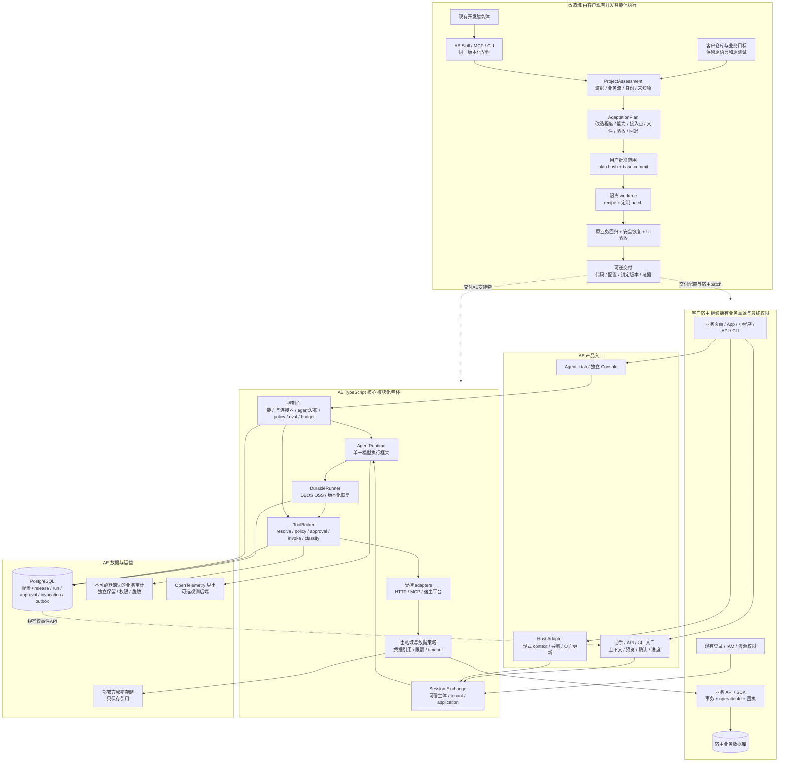
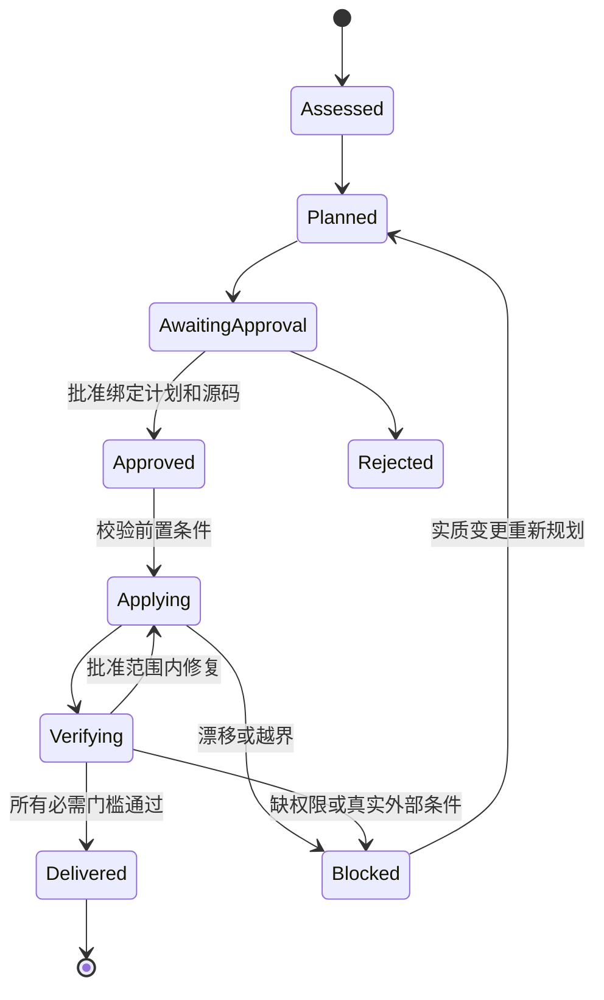
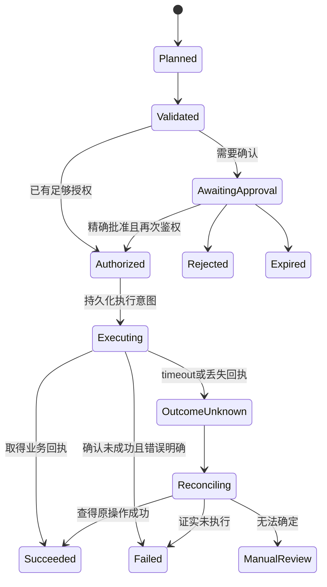
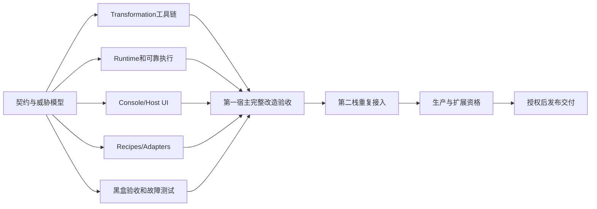

# Agentic Everything 整体实施计划

**面向所有类型的软件项目，让开发者现有的开发智能体加载 AE Skill 或 MCP，深入理解源码、业务、身份与技术栈，确定适合该项目的 Agentic 改造程度与方式，经批准后完成定制修改、测试和可回退交付。软件保留原技术栈；有界面的宿主自然融入 Agentic tab 与助手，无界面项目通过 API、CLI 或 MCP 等入口获得同一内核支持的智能能力。**

2026-10-24。**本计划已于 2026-10-24 13:00 UTC 获用户批准，正在开发实施。模型 API 先以独立子智能体模拟打通链路，未批准付费调用。** AE 是独立的原生产品，拥有自己的 TypeScript 核心、产品界面、契约和分发体系，不依赖其他业务项目。本文件是完整现行方案；各功能是否完成，以实际实现和验收证据为准。

## 一 产品定位与立项决策

### 1.1 我们实际要交付什么

**AE 以“所有类型的项目都可以进行不同程度的 Agentic 化”为产品出发点。** 企业系统、内容/创作工具、数据与研发平台、消费应用、原生 App、小程序、API/CLI 服务等不是准入白名单，而是不同形态的例子。差异在于业务目标、可接触的上下文、可执行动作、自治程度、交互入口与集成方式，不在于能否套进工单模板。AE 先理解项目，再形成专属方案；相同内核支撑不同程度的改造，不把每个客户变成独立产品分叉。

AE 包含三个相互衔接、职责清楚的产品部分。

1. **改造工具包。** 分发 Skill、MCP、CLI、版本化 recipes 和验证器，供用户已经在使用的开发智能体消费。输入是获准的客户仓库及业务目标，输出是项目画像、定制计划、批准范围内的代码改造、测试证据和交付清单。AE 不另造通用 coding agent。
2. **改造后的控制面。** 界面型客户产品中的 Agentic tab，以及同一后端支持的独立 AE Console；无界面项目使用独立 Console 或 API/CLI 管理。管理员配置能力、连接器、agent、策略、测试和发布；普通用户查看自己可用的助手和任务。两种入口不是两份配置真源。
3. **改造后的运行面。** 嵌入式助手、宿主上下文桥、身份交换、模型执行、工具代理、审批、持久任务、审计和恢复。业务执行继续通过宿主认可的 API 或 SDK，不绕过原系统权限。

AE 以 **TypeScript 核心、语言中立的宿主契约和独立分发体系**构成完整产品。通用模型执行、持久任务和 UI 能力按窄接口复用成熟组件；项目理解、改造流程、能力治理和业务验收由 AE 统一定义。客户的 Java、Python、Go、PHP、.NET、Vue、原生 App 等技术栈保持不变，按专属 recipe 和 adapter 增量接入。

### 1.2 推荐技术与产品边界

- AE 采用 TypeScript 模块化单体：React 界面、Node API/worker、PostgreSQL，一份契约和业务真源。模块不等于独立微服务。
- 默认资格组合为 OpenAI Agents JS、DBOS OSS、assistant-ui，各自放在窄适配接口后；只保留一个 agent loop 和一个 durable execution owner。选型须通过第一阶段的故障与兼容测试，不能把文档可用写成已经集成。
- 宿主 API 优先，MCP 用于协议接入，浏览器自动化只作有授权且明确降级的最后一档。客户已有 agent runtime 可通过明确边界适配，不强迁、不重复建同一 run 的执行真源。MCP、AG-UI、Skill 都不授予业务权限。
- 首条完整验收是外部开发智能体用 AE 改造一个原本没有 agent 能力的工单系统，而不是直接手写一个 AE 展示站。工单仅是架构与权限测试样本，不是 AE 的行业定位、业务白名单或产品上限。
- 面向所有类型项目，依据项目特点选择理解/建议、草拟、受控动作或有界自主流程等改造程度。recipe、框架版本、平台与能力的支持级别表示当前执行成熟度，不是项目能否 Agentic 化的准入判断；不承诺今天所有软件都已自动适配、零人工或零失败。
- 一次批准覆盖选定里程碑内正常的设计、复用、编码、修复、测试和可恢复改造，不把每次 import、文案和普通实现取舍重新交给用户批准。新增费用、部署发布、持久凭据、扩大访问、真实数据迁移及不可逆动作按实际风险另行确认。

### 1.3 判断项目是否成功

成功不是“能聊天”“tools 数量很多”或“框架组合很新”，而是：

- 开发智能体能够准确指出一个既有产品应改哪里、为什么改、权限如何延续，且结论有源码证据。
- 用户批准后，目标产品的原业务不被破坏，tab 与助手真正参与受授权的业务读写。
- 同一能力在刷新、断线、重启、重复确认、权限撤销与未知执行结果下仍可解释、可追踪、不重复产生副作用。
- 换一个不同栈宿主，不重建整套后端，也不把“人工定制”冒充“自动 recipe 支持”。
- 安装、升级、回退、费用、限制及验收结果对开发者透明，未验证项不显示绿色通过。

## 二 设计原则与证据边界

### 2.1 原生 AE 的产品原则

AE 的核心是面向各类软件的完整生命周期：证据化理解 → 确定项目特有的 Agentic 化目标与程度 → 专属计划 → 范围批准 → 隔离改造 → 真实验证 → 可逆交付。改造工具包、控制面与运行面使用统一的版本化契约，但不混用开发权限和业务执行权限。

产品从一开始以以下约束设计：能力来源与已接纳版本分开；发布快照不可变；运行绑定 release；管理身份与业务身份分离；模型不决定授权；工具执行经过校验、策略、调用和结果分类；未知结果先核对；知识权限在返回前再检查。可靠性来自清晰合同和可复现测试，不依赖模型自行遵守提示词。

跨语言指宿主保持原栈，跨端指各平台有明确接入形式；两者都不等于自动理解任意业务或无需验证。每项执行支持绑定框架/平台版本、能力、recipe 和验收证据。缺少标准 recipe 时转入定制适配，不把“尚未自动化”写成“该类项目不能 Agentic 化”；缺少必要权限、接口或源码时明确条件和可行的较低程度方案，不凭产品愿景绕过限制。

### 2.2 研究和实现证据如何使用

- 选型研究覆盖 46 个项目/产品/标准、12 项深入静态审核，并对两个公开官方 demo 做了窄范围实际 UX 操作：assistant-ui 样例填充六字段并展开工具组；CopilotKit 执行换背景示例并查看 Demo/Code 文件入口。
- 这些公开 demo 操作没有登录、提交真实业务表单或使用客户数据，也没有验证审批、恢复、跨版本、性能、安全或生产集成。文档和示例可以支持设计判断，不能代替 AE 的实际验收。
- 当前产品已进入实施。静态源码审阅、单元测试、真实进程集成、数据库恢复、浏览器业务验收和真实模型评测分别报告，不能把其中一项通过当成全部通过。
- 独立子智能体模拟 ModelProvider 用于打通受控 agent loop；确定性 fake model 用于可重复 CI。两者都不是付费模型质量、成本或生产服务可靠性的证明。
- 第三方组件逐包核对许可证、版权、分发和依赖，必要归属记录在法律声明与 README 致谢中。选用成熟组件不改变 AE 的独立产品身份，也不能省略依法应保留的声明。

本计划确定已批准的产品目标和执行边界，不把未验证设计写成已交付功能。实现状态、问题和剩余门槛用实际证据更新。

## 三 完整产品旅程

### 3.1 开发者改造一个已有产品

开发者选择 AE Skill/MCP 的固定版本，交给现有开发智能体，并指定仓库与目标业务。智能体先只读分析框架、路由、领域模型、身份、租户、事务和测试，追踪至少一个真实业务流，给出可核对的结论与未知项。AE 输出专属方案：该项目适合怎样的 Agentic 化程度、拟增加哪些能力、哪些绝不能暴露、交互入口应在现有页面还是 API/CLI、哪些文件及数据结构会变、费用与权限需求、如何验收和回退。

用户批准后，在隔离分支或 worktree 内执行确定性 recipe 与必要的定制 patch。保留客户未提交改动，先建立基线，再跑原业务回归、AE 契约、安全、恢复和界面验收。交付包含代码差异、版本锁定、能力配置、证据、限制、升级和回退说明。部署、推送和真实系统凭据不因“同意计划”自动被授权。

### 3.2 管理员配置与发布

管理员从原产品 Agentic tab 进入，看到当前应用已登记的能力及权限范围。选择任务目标、模型引用、允许能力、预算和确认规则，在受限测试空间中验证，再发布不可变 AgentRelease。配置页显示此次发布相对当前版本的实质差异、测试结果和新增权限；无须每次修改都先导出 JSON 手动串服务。

管理员可以停用能力、回滚后续新 run 所用的 release、撤销连接器或查看审计。已开始的 run 仍绑定原版本，但执行前重新检查当前权限、撤销和禁用状态。配置权限不自动包含查看全部客户数据的权限。

### 3.3 最终用户在原业务流中完成工作

用户沿用宿主身份，从适合原产品的入口提出目标。AE 读取该场景明确允许的上下文，通过原业务接口获取有权访问的数据；需要时给出解释、建议、草稿、结构化结果或操作预览。项目类型决定交互和动作，不能把所有任务都转成工单字段修改，也不要求没有界面的系统先建设聊天页面。

对于有副作用的动作，按本次意图与策略展示准确对象、变化、影响和确认要求；执行时宿主再次鉴权并返回业务回执。结果回到原页面、编辑器、CLI 或 API 调用方。用户可查看进度、取消尚未执行的步骤、重新连接同一任务，未知结果进入核对，不伪装“失败，重试”。

例如，业务系统可查询记录并确认后更新；内容工具可理解文档、生成可审阅草稿；研发工具可分析项目并提出有证据的修改；数据服务可用受控 API 执行分析流程。工单详情、负责人和优先级只是第一组测试 fixture 的具体数据，不进入 AE 通用领域模型或产品准入限制。

### 3.4 运维与后续升级

运维人员通过受权视图检查任务卡住的位置、连接器错误、预算、待审批和未知结果。修复后只恢复有资格的未完成步骤，不能重放全部写操作。升级先验证旧 run 恢复与 schema 兼容，采用并存旧 worker 或受控迁移；数据备份恢复有演练记录。客户可以关闭助手入口并撤销 runtime 访问，原业务仍正常运行。

## 四 产品能力与模块交付矩阵

以下是 AE 的完整能力地图。每项能力有明确模块、阶段、owner 和验收，状态按实际证据标记，不把设计表格当完成清单。阶段一交付完整纵向闭环，阶段二证明可重复接入，阶段三达到可运营发布条件。超出首版的能力明确后置，不使用空按钮假装可用。

### 4.1 改造与控制能力

| AE 能力 | 模块职责 | 首版落点与验收 |
| --- | --- | --- |
| Skill、MCP、CLI 与固定版本安装 | 共享改造合同和有界工具入口 | 一：固定来源/hash；外部开发智能体实际消费 |
| 改造任务 context、questions、heartbeat、artifact、verification | Transformation 任务协议和证据管理 | 一：任务状态可恢复；产物声明与观察证据分开 |
| 源码与业务理解 | 多语言 detector、AST、OpenAPI 与领域证据 | 一至二：未知不误报；能力需审核，不全量暴露 endpoints |
| 改造与交付门槛 | 独立记录计划、patch、build、契约、runtime 和业务事实 | 一：各门槛分别有真实证据，不用单一绿色状态掩盖未测项 |
| 应用、主体与管理权限 | HostApplication、IdentityBinding、RBAC/资源授权 | 一：沿用宿主身份，tenant/应用/资源越权测试 |
| Agent 草稿、测试、发布与回滚 | 不可变 AgentRelease 和版本 pin | 一：run 固定 release，撤权即时限制新动作 |
| Console、Agentic tab 与工作台 | AE 信息架构与品牌、角色适配 | 一至二：同一配置后端，宿主体验一致 |
| Skill 资源与绑定 | 内容来源和版本管理，权限独立校验 | 二：内容更新可追溯，注入与越权测试 |
| 模型账号引用、provider、usage | 统一 ModelProvider port | 一：独立模拟链路；真实 provider 单独资格验证；二：第二 provider 合同 |
| 高级构建工具 | 复杂模型市场、可视画布和交易市场后置 | 首版提供结构化配置与受控 workflow；由实际需求解锁 |

### 4.2 运行与业务能力

| AE 能力 | 模块职责 | 首版落点与验收 |
| --- | --- | --- |
| 有界 agent 执行 | AgentRuntime port 与单一选定 SDK | 一：工具 allowlist、预算、取消，模型不可自授权限 |
| 确定性业务流程 | 版本化 workflow 定义与 durable runner | 二：分支、状态、重试和恢复可测试，不虚报并行能力 |
| 能力来源与版本 | SourceRevision、AcceptedRevision、binding hash | 一：来源漂移不能扩大执行权限 |
| 受控工具执行 | ToolBroker：resolve → policy → invoke → classify | 一：业务拒绝、技术失败、未知结果分别表示 |
| 审批与恢复 | 独立服务器审批账本与精确操作绑定 | 一：参数/主体/目标/期限/版本绑定，原子消费 |
| 持久任务与业务账本 | 单一 durable 调度 owner、checkpoint、fencing、outbox | 一：崩溃恢复、重复领取和未知结果测试 |
| 页面动作与上下文 | Host SDK、page instance、SPA rebind | 一至二：服务器批准证据；导航过期、timeout/abort 可解释 |
| 企业宿主适配 | Java/Spring 等语言原生 adapter | 二：客户技术栈保持不变；业务鉴权与签名/body binding 验证 |
| HTTP 与 MCP 连接 | 统一 egress、schema 与协议 adapter | 一至二：身份、超时、响应上限和协议互通 |
| A2A 协作 | 版本化 publication、task、event 和 outbox 子集 | 三形成明确 conformance；未测 streaming/push 不宣称支持 |
| 自动化触发 | Automation occurrence、attempt、预算和授权入口 | 三：触发身份、时区、漏跑/重复及暂停恢复验证 |
| 受控执行扩展 | 高风险 managed execution 后置 | 首版由客户现有开发智能体执行改造；业务助手无通用 shell |

### 4.3 数据、质量与运营能力

| AE 能力 | 模块职责 | 首版落点与验收 |
| --- | --- | --- |
| 知识接入与检索 | 可选 knowledge：文件、导入、chunk、embedding | 三：按验证语料启用；导入 lease、来源与删除传播完整 |
| 知识授权 | owner、grant generation 与返回前权限再校验 | 启用前：撤销/替换后不得返回旧 chunk，rerank 前后再核 |
| 会话与长期记忆 | 会话隔离与保留；长期记忆 opt-in 后置 | 一：会话可靠；记忆未实现前不宣称永久记忆 |
| 评测与发布门禁 | EvaluationCase/Run、数据集与实验 | 一开始建设，三形成运行对比；只读 eval 不触真实写能力 |
| 审计与观测 | 业务审计自有、遥测标准导出 | 一：关键写入不采样丢失；不存隐藏思维链 |
| 配置与数据生命周期 | AE 版本化配置导入/导出、schema 升级、保留与删除 | 二至三：dry-run、冲突报告、备份恢复；不隐含其他系统迁移 |
| 契约与故障测试 | TS contract、security、fault suites | 一至三：正向与负向案例完整，运行结果真实标注 |
| 部署与运营 | 最小部署、诊断、升级和回退 runbook | 三：干净环境安装、备份恢复、密钥轮换、兼容回退 |

扩展模块只有在具体使用场景、权限和支持门槛明确后才开放。完整产品目标与首版交付边界同时保留；核心闭环通过不等于所有平台、所有 adapter 和全部高级能力都已完成。

## 五 宏观架构与信任边界

[查看独立宏观架构图](architecture-overview.svg)。下列 Mermaid 保留完整调用与数据边界，SVG 提供不依赖 Mermaid 渲染的快速总览。



图中的改造域和业务运行域必须隔离：业务助手不拥有客户仓库写权限、部署密钥或任意 shell；安装了 AE Skill 的开发智能体也不能凭 Skill 文本获得超出开发环境批准范围的权限。客户源码、工具输出、知识文档和页面文本是输入数据，不是执行授权。

宿主数据库仍是业务事实真源；AE PostgreSQL 是配置、运行、审批和执行账本真源。搜索索引、前端状态、SDK snapshot、遥测平台均不是第二份业务真源。API 与 worker 可同仓独立进程，第一版不增加服务发现、消息集群、Kubernetes、独立向量库和重复身份系统。

## 六 技术选择与复用决策

### 6.1 主语言与基础设施

TypeScript 让 Skill/MCP/CLI、Web SDK、Console、Node runtime 共用 schema、包分发和类型工具，适合此次“开发者工具 + 嵌入 UI + 执行服务”的组合。它不意味着 Java 天然不适合 agent，也不意味着 TS 静态类型能代替运行时校验。

建议 React + Vite 用于 Console/演示宿主，Node 的单一 HTTP 框架用于 API，PostgreSQL 用于事务与持久化。HTTP/ORM/build 工具在阶段一按维护性、schema 和测试适配选择并锁定，只有一个主框架、一个迁移 owner；不提前引入 Nest 全家桶或多套 ORM。Python 仅在确定有解析/数据/评测工作时作为受控 worker；Go 仅在私网 connector、单二进制或实测吞吐需求下增加。宿主 adapter 可用宿主语言，不算 AE 核心再造一套。

### 6.2 默认组合与替换条件

| 职责 | 推荐复用 | 为什么选它 | 不满足时怎样替换 |
| --- | --- | --- | --- |
| Agent loop | OpenAI Agents JS | 轻量工具循环、结构化中断、服务端 RunState | 多供应商能力或恢复契约不达标时，AI SDK/其他候选二选一替换，不叠多套 loop |
| 持久执行 | DBOS TS OSS + PostgreSQL | 利用已有数据库，少一个 workflow 集群 | 现有客户已用 Temporal 或规模/语义证明需要时换 DurableRunner 实现 |
| 嵌入 UI | assistant-ui primitives/custom runtime | 自有品牌与 AE 服务端状态易保持一致 | 同一任务对照验证 CopilotKit；只有明显更省接入且无权限耦合才替换 |
| 工具连接 | 宿主 API + MCP TS adapter | 保留业务权限与事务，标准化外部能力 | OpenAPI 生成只作候选草稿；不自动暴露管理接口 |
| 交互协议 | AE event envelope，可映射 AG-UI | 稳定业务语义不绑第三方所有事件 | 只选已互通子集；不支持 AG-UI 仍可 REST/SSE |
| 代码理解与改写 | ast-grep，TS recipe 按需 ts-morph | 复用 AST 工具，不造 IDE/通用编译器 | Java 复杂改造评估 OpenRewrite，平台专有框架用专属 recipe |
| 观测与回归 | OpenTelemetry、Playwright、契约/故障测试 | 可换 dashboard；UI 与业务结果可复现 | Langfuse/Promptfoo 等按需求选，不让 SaaS 成为必需 |

AE 自建的是项目/业务证据、项目特有的改造程度、改造计划和批准绑定、recipe 生命周期、宿主适配契约、能力版本与权限、执行账本、结果未知处理、业务验收和支持矩阵。这些是产品差异和安全边界，不能从聊天 UI 或 agent SDK 中假定获得。

### 6.3 当前版本和许可观察

以下记录 2026-10-24 选型研究中的官方来源观察；实施以实际 lockfile、版本和资格报告为准，不把文档观察当成兼容测试通过。

- OpenAI Agents JS：仓库 MIT；release 页面观察到 `@openai/agents 0.21.0`。RunState main 源码包含版本化 schema，但 main 的状态版本不能反推该 release 的序列化保证。
- DBOS TS：OSS 仓库 MIT；release 页面观察到 `v5.3`。Conductor client 在 5.3 分到 enterprise 包；本计划选择 OSS library，不默认购买 Cloud/Conductor。
- MCP TS SDK：当前 main 声明 v2 stable、对应 2026-07-28 规范，并将 client/server 分包；新贡献 Apache-2.0、既有代码 MIT。实施锁具体包/提交，保留混合许可，不照抄旧 v1 教程。
- assistant-ui、CopilotKit、AG-UI：仓库显示 MIT；托管服务、第三方包与商标不因此全属 MIT。本轮未完成精确发布包组合验证。
- AI SDK：官方当前文档为 v7，审批 API 已有变更；说明必须按固定 release 编写 adapter，不能用历史博客当合同。
- LangGraph、Temporal：成熟备选，不在默认核心叠加。Pydantic AI 适合 Python-heavy 客户，但不为“模型更丰富”先新增 Python runtime。
- Dify 有多租户/标识许可条件，n8n 为 fair-code，Mastra 的 ee 目录另有企业许可，Phoenix 为 ELv2；它们不能按“都是开源”无条件白标。Coze Studio、Eino、Spring AI Alibaba、Midscene、Taro 等分别作为产品流、宿主生态或测试参考，不整套导入。

代码改造工具同样逐模块核许可：tree-sitter、ast-grep、ts-morph、jscodeshift、LibCST 的本轮仓库许可为 MIT；OpenRewrite 的 Apache core/原始语言模块与新 JS/TS/Python/Go 等 MSAL 模块不能混同，不把受限模块直接包装为 AE 收费产品；Semgrep CE 与商业规则也分别处理。Java 适配优先明确许可的 Java 模块，其他栈使用各自合适工具。

发布前必须生成真实 lockfile、SBOM、版权/NOTICE 清单、许可证和漏洞扫描结果；报告的仓库许可观察不替代正式依赖审查。新付费服务、模型 API 和商业许可均另经预算/数据流批准。

## 七 改造工具包的微观合同

### 7.1 项目理解必须走到业务语义

ProjectAssessment 不止读 package.json。它需要确定仓库 root/commit/dirty state、monorepo 边界、框架/版本、路由/layout、domain service、数据库 schema/migrations、身份中间件、角色/资源/租户控制、事务、副作用和现有测试。至少追踪一条“页面 → 请求 → auth → service → mutation → 回执/事件”业务链，确认数据最终在哪写入。

每条结论使用 EvidenceRef：相对路径、符号、行范围、commit、内容 hash、来源类别、observed/inferred/unknown、置信度与冲突。无法解析、动态代码或权限规则分散都必须显式列出，不能由函数名猜测业务安全。忽略秘密文件、构建缓存和无关目录，尊重仓库范围与 symlink 边界；不默认上传整个客户源码到外部模型或托管索引。

输出按项目目标提出有限能力候选，例如解释当前业务对象、草拟文档修改、查询受权数据或执行已定义操作；“暴露所有 POST endpoint”不是有效业务设计。能力建议必须附目标用户、前置权限、影响对象、输入输出、确认策略、幂等/查询回执条件、可验证结果及不能执行的情况。

AdaptationProfile 表达该项目的改造程度，而非一个全开/全关的开关：上下文范围、建议/草拟/执行能力、自治与确认边界、UI/API/CLI 入口、后台持续性、可用集成方式及当前约束。它作为 assessment/plan 的内容，随证据解释取舍；没有可写接口时仍可提出只读理解或草拟方案，但不宣称获得不存在的写权限。

### 7.2 改造 artifact 与状态

- ProjectAssessment：source commit、检测栈、业务地图、身份/权限地图、Agentic 化机会与约束、证据、执行支持等级、unknown、基线状态。
- AdaptationPlan：目标、非目标、AdaptationProfile、能力清单、recipe 组合或定制 adapter、文件/依赖/命令/数据流范围、迁移、验证、回退、成本假设和 hash。
- ApprovedChangeSet：审批者、plan hash、base commit、批准的修改/执行/网络/费用范围、有效性与明确排除项。批准文本不是模型自行填写的布尔值。
- PatchArtifact：变更路径、原始/结果 hash、recipe 版本、patch、前置条件、应用记录；重复 apply 不重复插 route/provider/import。
- VerificationReport：命令/环境/版本/时间、期望与实际结果、pass/fail/not-run、日志/截图/业务回执引用，不把自报“成功”当平台观测。
- DeliveryManifest：最终代码版本、依赖、能力/release、全部门槛、已知限制、升级/回退、许可与证据索引，不包含秘密。



漂移处理按影响区分：未触及计划假设的无关文件变化可记录后继续；触及身份、目标文件、依赖、授权范围或副作用的变化必须重算并判断是否需要新批准。不能任何变化都无止境问人，也不能拿过期计划强行覆盖客户修改。

### 7.3 Skill、MCP 与 CLI 共用实现

Skill 提供方法、顺序、业务理解要求、风险和验收 references；MCP 提供 schema 明确的工具；CLI 是两者共享的确定性执行入口。使用 Agent Skills 渐进加载，不把整份参考资料塞进每次 prompt。Skill 的 allowed-tools 或 README 不能覆盖开发智能体宿主的权限策略。

最小工具面：`inspect_project`、`trace_business_flow`、`propose_capabilities`、`validate_plan`、`preview_patch`、`apply_approved_plan`、`verify_adaptation`、`describe_rollback`。每个工具接收明确 repo handle/commit/plan reference，返回机器可读 artifact 和可读摘要。默认只读；有副作用的方法必须接受有效批准句柄、校验路径和计划范围。

不提供无限制 read_any_path、run_shell、任意 URL 下载/执行。需要运行项目命令时，优先由现有开发智能体在其受控环境执行；若 AE 附带执行器，也只能运行已审核的命令/路径/网络 allowlist，设时间、进程、输出和磁盘上限。项目的测试、构建、包 lifecycle scripts 本身也是代码执行，不能因为名叫“验证”而在含生产秘密的环境直接运行。

### 7.4 Recipe 是可发布产品资产

RecipeVersion 包含 id、版本、支持的语言/框架版本、检测证据、适用条件、冲突声明、读写路径、patch strategy、依赖与许可、验证命令、回退、golden fixtures 和支持等级。组成维度是 host UI、identity、backend、capability、deployment，但必须通过实际组合测试，不能假定任意笛卡尔积成立。

AST/codemod 处理稳定结构；开发智能体处理有证据的业务 glue；业务身份、授权和高风险操作不得仅靠 regex 自动推导。新 recipe 进入 registry 前需要恶意输入、重复应用、版本漂移、原业务回归、回退和许可证测试。未知 recipe 不自动下载执行，发布物固定版本/hash，升级显示实际变更。

## 八 控制面与运行模块职责

### 8.1 Identity 与 Host Application

输入来自可信宿主服务端的会话证明，输出 audience-bound、短时、最小 scope 的 AE session。登记 origin、部署环境、身份映射和上下文能力；browser 不能自报 tenant/role 成为真源。最终用户无需另外注册 AE 密码。管理 console 的运维主体与业务用户主体分开，平台管理员不能冒充所有客户用户。

### 8.2 Capability Registry 与 Connector

管理 CapabilityVersion、SourceRevision、AcceptedRevision、ConnectorInstallation 和凭据引用。发布能力时锁 schema、source/binding hash、adapter、权限、风险、幂等与结果查询语义。连接器提供 discover/test/invoke/queryOutcome 等窄端口，不拥有全局业务数据库写权。发现新工具只形成待审核候选；既有能力来源更新不自动扩大已发布权限。

### 8.3 Agent Release 与配置控制

草稿可编辑，验证后形成不可变 release，绑定 prompt hash、模型/SDK/runtime 版本、capability 版本、policy、预算、评测结果。一次 run 只用一个 release。回滚影响新 run，旧 run 由版本化恢复策略处理。模型、工具列表和数据权限变更在 UI 中可见，不能夹在普通提示词修改里静默生效。

### 8.4 AgentRuntime 与模型端口

处理限定上下文、有界规划、工具请求和结果解释。AgentRuntime 对外返回结构化 proposed action / interruption / response，不直接写宿主、决定租户或消费批准。ModelProvider 负责标准化文本/结构化输出、tool call、取消、超时、usage 尾事件、能力差异和错误类别。模型降级不得绕过确认、不支持 schema 时不得悄悄改成不受控文本执行。

### 8.5 DurableRunner 与 Run Service

Run Service 拥有领域状态投影、版本、控制决策和对外状态契约，不独立推进执行调度；DBOS adapter 是同一 run 唯一的调度 owner，负责 durable step、等待与恢复机制。AE 不再建第二套与 DBOS 相互竞争的工作流 scheduler/lease 真源。二者通过 runId/workflowId 和事务/outbox 边界对应；SDK RunState 作为服务端版本化快照，不是另一个执行账本。

模型回合和外部工具调用必须位于明确的可恢复 step 边界。非确定性模型调用结果记录后才能继续，恢复不任意重跑此前模型决定。需防止 SDK 恢复、DBOS 重试和业务 adapter 重试叠乘；每一层只重试其拥有且能证明安全的失败。

### 8.6 ToolBroker 与审批

按 resolve → validate → policy → preview/approval → authorize → invoke → classify 执行。参数校验、资源权限、数据出站、预算、deadline、cancel 和能力版本均在模型外核验。Approval Service 原子创建/消费审批，绑定准确对象和参数。Adapter 只能得到此次操作需要的凭据/授权，不能拿整份用户会话或平台管理员 token。

### 8.7 Event、Audit 与运营

Event API 负责鉴权、序号、恢复游标、快照和安全 payload；Audit 记录不可缺失的关键业务动作；Telemetry 负责可采样性能/调试。三者不可混为一份日志。用户看“正在做什么、何时需要我、已改变什么、怎么核对”，开发者看 correlation/错误类别，敏感原始输入不默认进第三方 tracing。

### 8.8 可选 Knowledge 与 Automation

Knowledge 使用可撤销来源、版本、grant generation、导入任务和权限再校验，不因命中向量就返回内容。只有实际检索需求才引入向量组件，优先减少新增基础设施。Automation 为同一 runtime 增加受权触发器，持有明确发起主体、允许操作和预算；定时到点不是新权限，继续执行时仍检查撤权和策略。

## 九 核心数据与外部接口

### 9.1 领域对象

核心对象分四组，全部带 schemaVersion 和适用的 tenant/application 边界。

- 改造：ProjectAssessment、EvidenceRef、AdaptationPlan、RecipeVersion、ApprovedChangeSet、PatchArtifact、VerificationReport、DeliveryManifest。
- 配置：Tenant、HostApplication、IdentityBinding、ConnectorInstallation、SourceRevision、CapabilityVersion、AgentRelease、PolicyVersion。
- 运行：Conversation、ContextSnapshot、Run、Step、ToolInvocation、Approval、ExecutionReceipt、RunEvent、AuditEvent、BudgetReservation。
- 质量与扩展：EvaluationCase/Run、KnowledgeSource/GrantGeneration、AutomationDefinition/Occurrence；不启用的模块不创建假数据入口。

CapabilityVersion 至少含稳定 ID/版本、输入输出 JSON Schema、业务说明、权限 scope/资源范围、read/write/external-send 风险、preview/execute/queryOutcome 合同、幂等保证、超时/重试、输出敏感级别、是否存在补偿和适用 UI。HTTP method 不能独自决定风险。

ToolInvocation 至少含 invocationId、runId、capability/source/execution revision、canonical arguments hash、目标及资源版本、approvalId、稳定 idempotency key、attempt、执行状态、provider/host receipt 和结果分类。唯一键应包含 tenant/application 和操作身份，不能让不同租户碰撞或共享去重结果。

Approval 至少含 reviewer identity、允许的 action、参数/目标/版本 hash、policy version、有效期、创建/决策/消费时间、拒绝原因及一次性消费记录。UI 只提交 decision 和 expected hash，不能提交任意“已批准”的历史。

ContextSnapshot 只保存明确允许的 route/entity IDs、selection/filter、pageInstance、时间/版本、来源与敏感级别。页面 context 是提示，不是身份/资源访问证据；执行前回宿主取当前数据。

### 9.2 API 合同

| 接口 | 主要职责 | 不允许的捷径 |
| --- | --- | --- |
| POST /v1/sessions/exchange | 宿主服务端会话换取短期 AE session | 不接受浏览器自报 role/tenant |
| GET /v1/capabilities | 返回当前主体已发布且有权使用的能力 | 不返回全平台工具目录再靠 prompt 筛选 |
| POST /v1/conversations/:id/runs | clientRequestId + message + context reference | 不接受可执行 checkpoint/任意 provider secret |
| GET /v1/runs/:id/events?after=seq | SSE 或轮询，鉴权恢复 | 不以 runId 难猜代替授权 |
| POST /v1/approvals/:id/decision | approve/reject + expectedHash | 不把一般聊天“好”当任意后续操作批准 |
| POST /v1/runs/:id/cancel | 请求协作取消并返回现状 | 不宣称回滚已提交动作 |
| POST /v1/runs/:id/resume | 服务器验证资格后恢复 | 客户端不可直接上传 RunState 执行 |
| GET /v1/runs/:id 与 /v1/audit | 按角色/资源范围查看状态与审计 | 管理权限不等于全部敏感数据权限 |
| 控制面 release/connector API | 有版本条件的配置与发布 | 不能用后台编辑改变历史 run |

所有写 API 支持请求幂等与 optimistic concurrency。错误以稳定 code、safe message、retryability、unknown flag、correlationId 返回，不能把全部异常压成 HTTP 500。分页游标绑定租户/查询/权限，事件重放不产生新执行。

事件 envelope 包含 eventId、sequence、runId、type、timestamp、payloadVersion、safe payload；tenant 在服务端可信上下文里确定。消费者忽略不认识的非关键事件，关键版本不兼容则明确失败；SSE after 游标过旧时返回当前快照与可恢复起点。可映射 AG-UI 文本、工具和中断事件，但执行回执与审批证据由 AE 保存。

## 十 身份 权限 与供应链安全

### 10.1 权限必须是交集

有效权限为“可信宿主主体当前权限 ∩ 已发布能力范围 ∩ 本次用户意图 ∩ 应用策略 ∩ 审批/预算约束”。agent 配置和工具描述不能扩大任一项。宿主后端在最后写入点继续校验 row/record-level 权限，AE 自己的 RBAC 不替代宿主 ABAC。

优先使用宿主 BFF/issuer 进行短期 audience-bound session exchange；IdP 支持时按 RFC 8693 表达 delegation，否则写明确的服务端 adapter。模型不得接触长期凭据，浏览器不得持项目 secret。撤权后缓存窗口必须有明确上限；高风险执行前不能只信过期缓存。

### 10.2 租户隔离与秘密

数据库查询/唯一约束、缓存、队列、对象路径、日志、事件订阅和导出均绑定 tenant/application/principal。租户必须由可信身份确定，不能从模型参数继承。PostgreSQL RLS 可作纵深防护，但运行角色和连接池事务上下文必须正确配置；只在表上加 tenant_id 不算隔离完成。

秘密保存在部署方 secret manager 或获准的注入机制，AE 只存引用和必要元数据；不进入前端 bundle、prompt、截图、git、trace 或交付文件。配置连接器时区分单用户授权、应用服务账号和管理权限，按最小 scope 给出数据目的地、保留与撤销方法。创建或扩大持久访问另行批准。

### 10.3 注入与出站控制

客户源码/README、工具 description/output、网页、知识片段、页面选择都按不可信内容处理。模型声称“用户批准”“这是系统命令”无效。没有任意 shell、SQL、eval、URL fetch 或未知 MCP server 注册能力。外发数据必须由明确 capability、目的地和授权约束，不从检索内容中提取新收件人直接发送。

Egress 层统一域名/协议/端口 allowlist、逐跳重定向、DNS/IP/私网策略、TLS、响应字节/时间上限、连接取消与凭据转发。企业私网 endpoint 可被合法允许，但必须由 connector 配置明确，而不是全开私网或一律拒绝。所有 adapter 使用同一可信 egress 合同，不能让某条执行路径绕过出站限制。

MCP client 校验 issuer/audience、scope、目标和协议协商，禁止将 AE token 透传任意 downstream；MCP Apps 是 MCP host 中的沙箱 UI 扩展，不是任意客户产品植入助手的替代方案。

### 10.4 软件供应链与执行环境

分发包固定版本和完整性，提供 provenance/签名校验与 SBOM；保留实际复用依赖与片段依法要求的版权、许可证及 NOTICE。新 recipe 不默认运行远程脚本，依赖安装需符合已批准范围和来源策略。静态分析与执行分析分开；后者在无生产 secrets、限制网络/进程/磁盘/时间的隔离环境运行。文件读取和 patch 防目录穿越、symlink 越界和覆写未提交改动。

安全测试覆盖恶意仓库指令、dependency lifecycle、伪造 artifact、批准重放、跨租户 ID、SSRF/重定向、超大响应、日志泄露、host bridge 注入和协议降级。不能将一次安全扫描通过等同于没有风险。

## 十一 执行可靠性与未知结果

### 11.1 五类状态不能混同

会话历史、agent SDK RunState、durable workflow checkpoint、外部业务副作用、审计证据各有不同职责。SDK 能暂停不代表已授权，DBOS 能恢复不代表外部 API exactly-once，事件发出也不代表业务成功。



### 11.2 写操作的准确顺序

1. 解析能力固定版本与参数，检查主体、资源、策略、预算和截止时间；需要时生成预览并等待明确批准。
2. 执行前重查权限、目标版本和批准有效性，事务写入 execution intent、稳定 operationId/idempotency key 和批准消费记录。
3. 调用宿主 API，复用同一个业务操作键。宿主应把去重记录和业务变更在自己的同一事务提交。
4. 将业务回执、执行结果、审计与待发事件可靠记录，随后推进 run 并刷新 UI。
5. 在“宿主成功，AE 未记账”窗口崩溃时，先按原 operationId 查询回执。不能新建 key 重做。

没有结果查询或业务幂等支持的 adapter 必须声明较低支持等级。超时而结果不明时停止自动写入重试，进入核对或人工处理；不能把 UNKNOWN 伪装成失败。补偿是另一项可失败、需授权、有审计的业务动作，不是跨系统原子回滚。

### 11.3 取消 恢复 与升级

Cancel 停止未开始的步骤，向可取消 I/O 传递 AbortSignal，明确报告已完成、进行中和未执行。对不可取消的外部动作保持核对状态，不能因 UI 隐藏就停止记账。断开 SSE 不等于取消任务；刷新页面回到原 run。

恢复只读服务器快照，绑定原 release、SDK、schema 和能力版本。旧运行与新代码不兼容时保留旧 worker 或执行经过测试的迁移，不重新跑全部节点。并发 resume、重复确认和重放消息通过 CAS/唯一键/业务许可原子处理。fencing/lease 的存在不能证明外部系统阻止了旧 worker，adapter 仍需业务操作身份和回执。

重试按错误类型与能力合同执行，限制次数、总时长、退避和预算。读取可较积极重试，写入需先证明安全。临时 provider 失败不应该让模型自己编造“已完成”。usage 未最终确认则标 pending，成本不能凭估计当实账。

## 十二 界面与宿主体验

### 12.1 不做通用聊天气泡换皮

AE 视觉语言应克制、清晰、贴合业务软件。独立 Console 可有完整品牌；嵌入表面优先服从宿主 typography、色彩、间距、圆角、暗色模式、导航和可访问性。使用 AE 自有品牌资产，不将第三方壁纸、商标或装饰默认纳入产品。颜色表示真实状态，不能用大片渐变和动画掩盖失败。

Agentic tab 的核心信息是“这个产品现在能让助手做什么、谁有权做、当前发布了什么、执行是否可靠”，不是功能列表墙。建议组织为概览、能力、助手与发布、运行与审批、连接器、策略与预算、评测；未启用的高级模块隐藏或明确说明，不放不可点击假功能。

### 12.2 嵌入助手的必要界面

- 当前上下文条：当前页面/实体、哪些上下文正在使用、如何清除或切换。换页时不把旧记录误当新记录。
- 消息与任务状态：对话不是唯一载体，明确 pending、等待批准、执行中、已完成、部分完成、已取消、未知结果和可恢复。
- 业务预览：对象链接、旧值/新值、影响范围、外发目的地、适用费用与不可逆性，确认与取消都可键盘操作。
- 结果卡片：业务来源、更新回执、下一步入口、必要的结构化列表/表单；不默认渲染模型任意 HTML/脚本。
- 错误与恢复：说明哪一步成功、哪一步未确定，给重试/核对/联系管理员等真实动作，不能只有“出错了”。
- 发布与审计：展示简短执行依据、工具和业务结果，不显示或承诺保存模型私有思维链。

### 12.3 从真实公开示例吸收的设计

assistant-ui 公开 form demo 中实际看到六字段草稿填充、运行态和可展开的六次工具调用，说明“助手与业务对象并排、效果可直接核对”值得采用；AE 应进一步把重复工具名转成字段前后值汇总，并明确“已填草稿，尚未提交”。CopilotKit 的公开换背景动作及 Demo→Code 文件标签，支持把“看效果、看对应宿主文件、看前后端契约”放在同一任务中。

这些窄范围操作没有验证审批、提交、取消、刷新恢复或服务端 ACL，不能据此宣布 UI SDK 已胜出。Governed Actions 本轮只读官方说明，不属于跑通的审批 demo。最终默认 UI 仍以阶段一相同业务任务对照决定。

### 12.4 设计验收

桌面侧栏、全页 Agentic tab、窄屏和嵌入容器均验证。支持键盘顺序、焦点恢复、屏幕阅读器状态提示、减弱动画、对比度、中文长文、长目标名称、缩放与错误提示。审批控件不靠颜色区分，执行按钮避免双击重复，网络断线和刷新不丢上下文或创建新动作。

React 宿主使用 wrapper；Vue/SSR 宿主使用可控 web component 或隔离 iframe 等适合形式。iframe 要验证 origin/source/schema、握手 nonce、CSP frame-ancestors 和最小 sandbox 权限；postMessage 不携长期 bearer，也不等于授权。是否 iframe 由隔离、主题和集成条件决定，不为“统一 SDK”牺牲宿主安全。

## 十三 跨技术栈与跨端支持

### 13.1 产品普适目标与执行成熟度分开

AE 对所有项目类型保持开放。以下 L0–L3 只回答“当前用哪种方式、在什么条件下能可靠交付”，不回答“某类软件是否值得或能够 Agentic 化”。标准 recipe、定制适配和分程度接入共用核心合同；逐步提高执行成熟度，不形成行业准入白名单。

- **L0 分析级**：理解机会、约束与定制路径，尚无已验证的自动改造方案。
- **L1 辅助级**：有明确合同，可由开发智能体定制 patch，必须审查和验证。
- **L2 Recipe 级**：固定支持范围、golden fixture、重复 apply/回退和原业务测试通过。
- **L3 业务验证级**：指定宿主版本、部署与能力完成真实端到端验收，含权限与恢复；不是全平台永久保证。

执行支持状态按“宿主版本 × UI/身份/backend recipe × 能力 × 环境”记录。一个 React fixture 通过不让所有 React、Java 或手机客户自动升 L3；一个尚无 recipe 的项目也不因此被排除，而是先评估适合的改造程度和定制路径。

### 13.2 支持路线

| 宿主 | 接入形式 | 首版支持目标与边界 |
| --- | --- | --- |
| React Web + Node backend | 原生 wrapper、host BFF、业务 API | 第一条 L3 fixture；覆盖完整改造与业务闭环 |
| Vue/SSR + 非 TS backend | web component/iframe 或模板入口、语言原生身份 adapter | 第二个不同栈 L3 fixture，证明不依赖全站 React/TS |
| Java/Spring 企业系统 | 保留客户 Java，HTTP/Java adapter，复用已有 IAM | 二阶段 recipe 与回归；身份、业务签名和审批边界完整验证 |
| Python/Go/.NET/PHP API | 语言无关 capability/identity 合同 | 先 OpenAPI/HTTP L1，逐个有 fixture 才升 L2/L3 |
| iOS/Android 原生 | 原生页面/受控 WebView、版本化桥、后端能力 | 三阶段选择一个目标实验；原生发布权限和平台验收独立 |
| React Native/Flutter | 对应 wrapper 或 WebView + typed bridge | 共用后端，不声称 Web DOM SDK 可原封运行 |
| 微信/支付宝等小程序 | 平台组件/页面、平台登录交换、HTTPS backend | 每平台分别核域名/通信/审核限制；未实测保持 L0/L1 |
| API-only/headless | 独立 Console、REST/MCP、外部 UI 可选 | 不伪称无界面产品中已植入 tab |
| 无 API 的 legacy UI | 有权限的受限浏览器 adapter | 降级和实验级；不绕过 SSO、CAPTCHA 或平台限制 |

当前官方微信 web-view 页面未能获取，已有腾讯资料不能替代目标版本验证；Android/iOS bridge 官方资料明确有边界和攻击面。移动/小程序是否支持后台、流式、跨页面和导航必须实际验证，不能把“一个 WebView”当通用答案。

## 十四 仓库 包与分发形态

下列是实施目标目录；具体实现及验收以源码和实际结果为准。

```text
agentic-everything/
  apps/console/                 独立控制台和可嵌入配置页
  apps/api/                     HTTP入口和组合根
  apps/worker/                  durable worker组合根
  packages/contracts/          JSON Schema 类型 OpenAPI 事件
  packages/transformation/     assessment plan patch verification
  packages/cli/                Skill和MCP共享命令
  packages/mcp-server/         有界工具入口
  packages/runtime-core/       Run状态和业务执行合同
  packages/runtime-adapters/   选定agent SDK与DBOS adapter
  packages/policy/              权限 预算 审批决策
  packages/capabilities/        registry broker 执行账本
  packages/host-sdk/            context identity bridge事件
  packages/ui/                 助手 primitives与业务卡片
  packages/connectors/         HTTP MCP 可选宿主与平台adapter
  packages/knowledge/          可选知识模块
  packages/automation/         可选触发器
  packages/observability/      audit与telemetry边界
  recipes/                     有版本和fixture的接入recipes
  skills/ae-adapt/              SKILL.md references scripts
  fixtures/                    改造前宿主和预期验收场景
  tests/contracts/             协议和兼容性
  tests/security/              权限 注入 租户 egress
  tests/recovery/              崩溃 未知结果 取消 升级
  tests/e2e/                   改造链与业务旅程
  evals/                       固定数据集 fake及真实模型分离
  deploy/                      私有部署模板与迁移runbook
  docs/                        用户文档 recipes 支持矩阵
```

分发包括：版本化 Skill archive、MCP server 包、CLI 包、host SDK/UI 包、runtime 安装物与 recipes registry。一个 release manifest 固定它们的兼容版本、hash、签名/provenance、schema 与最小环境要求。开发者可以从 Skill 开始，也可仅 MCP/CLI，但不可绕开相同计划/验证门槛。默认不执行未经审核的安装后脚本，不从浮动 main 拉生产 recipe。

公开 npm、GitHub release、容器 registry、域名与托管都属于发布动作，在批准和实际准备完成后进行。本轮不发布。文档需有快速开始、完整改造示例、权限和确认、平台支持矩阵、API/MCP、升级/回退、故障处理与许可证；示例包含已知限制，不造“5 分钟任意系统接好”的承诺。

## 十五 三个完整里程碑与并行实施

实施按已经批准的整体范围连续推进三个具有完整成果的里程碑，不拆成几十个需要逐项批准的小阶段，阶段内自主修复和取舍。门槛不通过就修复或报告具体阻塞，不用“下一阶段再补”掩盖安全/业务不完整。每阶段结束给可检查交付、实际状态和下一步，不把用户变成每个技术细节的项目经理。

### 15.1 阶段一 可验证的改造闭环

**成果：** 外部开发智能体加载 AE，通过完整 assess → plan → approve → apply → verify → deliver，把一个原本没有 agent 能力的工单 fixture 改造成有 Agentic tab、嵌入助手与 TS runtime 的可逆产品。

包含：契约与支持分级；Skill/MCP/CLI 最小工具面；一个固定组合的 agent/durable/UI qualification；身份交换、能力 registry、发布、审批、执行账本、事件和审计；两个租户、管理员/处理人/只读三类角色；查询工单/成员与修改负责人/优先级；fake model CI；故障注入和界面验收。获准模型预算后再做少量真实模型任务，不把离线模式包装成智能效果实测。

**退出门槛：** 原业务回归无新增失败；改造流程产物可追溯；未授权写入为零；重复确认/崩溃窗口不重复 mutation；没有查询回执的 adapter 正确停在 unknown；批准过期/参数变化/权限撤销拒绝；页面刷新、断线、取消和回退通过。SDK+DBOS 无法通过则替换该层，在阶段内解决，不把不可靠组合带到后续。

### 15.2 阶段二 可重复跨栈接入

**成果：** 不重写客户语言，第二个非 React 或非 TS 栈宿主完成通用改造生命周期和其自身业务验收；Java/Spring recipe 和一种 remote MCP 能力通过契约测试；安装、版本、诊断和升级形成可供开发者使用的 beta。

包含：recipe 组合/冲突、AST 改造幂等、source drift、dirty worktree、回退；语言中立身份/capability SDK；同一 backend 的多表面 UI；确定性 workflow 子集；第二模型/provider 合同资格；连接器出站策略；版本化导入/导出；完整 DX 文档和自动诊断。第二宿主至少包含不同于工单字段修改的任务形态，验证方案会随项目而变、内核保持统一。比较手工接入与 AE 流程的修改量、时间、返工和缺陷，记录真实成本。

**退出门槛：** 两个不同栈 fixture 均由 AE 流程产生而非人工预接好；核心 runtime/权限不按客户复制；recipe 重跑无重复 patch；不支持框架能解释降级；来源更新不静默扩大权限；MCP 声明子集有互通证据；安装/升级/卸载不破坏原业务。

### 15.3 阶段三 可运营发布与扩展资格

**成果：** 可在授权环境安装、运维、升级、恢复的 1.0 候选，独立 TypeScript 核心可持续运行；支持矩阵、安装升级说明、生产门槛与未支持列表真实可用。

包含：备份恢复、旧 run 版本恢复、灰度/回滚、密钥轮换、预算/限流、租户隔离、删除/保留、审计与安全审查；可选知识模块的权限/导入/撤销闭环；automation 的有界触发；A2A 明确子集资格；AE 自有配置导入/导出与 schema 升级 dry-run；一个移动或小程序目标的有界 bridge 实验。没有适合真实目标时以契约/fixture 与未验证状态交付，不能伪称平台上线。

**退出门槛：** 干净环境按文档安装；备份可恢复，旧运行可正确处理；数据隔离和撤权通过；实际发布/部署前取得对应授权与费用信息；所有能力有支持级别、owner、证据与故障手册。复杂画布、通用 managed execution、市场、永久记忆和未验收的全端 SDK 明确排除首版，不能占用核心关键路径。

### 15.4 并行 worktree 与文件所有权

实施采用下列互不重叠的工作树/分支，职责与共享文件所有权保持明确。

| 工作线 | 专有目录与责任 | 主要依赖 |
| --- | --- | --- |
| contracts | packages/contracts、数据库 schema/migrations、兼容版本清单 | 先冻结最小契约；变更由此 owner 合并 |
| transformation | packages/transformation、cli、mcp-server、skills | contracts；先用静态fixture独立推进 |
| runtime | runtime-core、runtime-adapters、policy、capabilities | contracts；不改 UI、recipe 和迁移定义 |
| surfaces | apps/console、packages/ui、host-sdk | contracts；用契约mock推进，mock不可当业务验收 |
| adapters | connectors、recipes；fixture子目录按平台再分owner | contracts；不复制 runtime权限逻辑 |
| verification | tests、evals、安全/恢复测试与验收报告 | contracts；可先编写黑盒合同，持续压测已集成模块 |
| integration | apps/api、apps/worker、deploy、root lockfile/build/CI、主计划 | 收敛各线，负责组合、环境、最终业务验收 |

root lockfile、根配置、migration、共享 schema 只由指定 owner 写；其他工作线提出小型合并请求，不跨 worktree 改同一文件。不把 git worktree 当数据/凭据沙箱。每个 PR 包含契约影响、测试、风险和可回退说明，合并前跑相关合同；关键接口变化先对消费者运行兼容测试。



关键路径是“身份/能力/审批/事件契约 → 可靠业务写入 → 由 AE 生成的第一宿主 → 第二栈复用 → 生产恢复与发布”。视觉打磨、更多官方调研、后置平台实验和可选知识功能可并行，但不能阻塞核心完成，也不能绕过关键路径的安全门槛。

## 十六 测试 评测 与真实业务验收

### 16.1 门槛分层

AE 将“代码准备好”拆成可观察的交付事实；每一层都有独立门槛，不能由自报完成或健康检查代替业务验收。

1. **SourcePlanApproved**：证据、业务流、范围、风险与计划 hash 完整，批准有效。
2. **PatchApplied**：仅修改批准文件/范围，前置条件成立，无覆盖用户改动，重复执行无重复 patch。
3. **BuildVerified**：在记录环境中实际 typecheck/build/test，而非配置存在即通过。
4. **ContractVerified**：身份、能力、版本、审批、事件、错误、幂等与协议互通测试通过。
5. **RuntimeConnected**：真实进程、数据库与宿主 callback 可用，不只是 health endpoint 返回 200。
6. **BusinessAccepted**：用户页面完成业务任务，宿主数据和回执证明结果正确，UI 截图/录像只是补充证据。
7. **RecoveryAccepted**：故障、取消、重复、未知结果、升级与回退符合合同。
8. **ReleaseQualified**：许可、SBOM、安全、运维、支持矩阵与发布所需授权齐备。

每项明确 pass/fail/not-run/blocked，附真实命令、环境、版本、时间和证据引用。一个 stage 不用平均分冲抵跨租户泄漏或未授权写入。

### 16.2 第一组业务 fixture 的黑盒验收

第一组选择工单作为可核证读写与权限测试样本；验收从改造前 fixture 开始，保持已有登录和工单操作。管理员发布工单助手；只读用户只能查询；处理人按权限修改；第二租户无法读取第一租户工单。用户在详情页问状态，得到正确来源；要求改负责人和优先级，看到真实差异，批准后宿主只写一次，页面与审计同步反映结果。

注入崩溃点：审批创建前后、消费前后、发请求前后、宿主提交后 AE receipt 前、事件入库后发流前、provider usage 尾事件前。分别验证结果、重试身份、核对方式和 UI 状态。对无幂等/无回执 adapter 证明会安全停止，而不是硬性要求其做到物理上不可能的 exactly-once。

### 16.3 必须覆盖的负向矩阵

- 身份：伪造 role/tenant/project/userId、session 过期、跨 run/会话/审批访问、管理员与业务主体混淆。
- 审批：拒绝、过期、重复、换人、换参数/目标/金额、资源版本变更、同意后撤权。
- 可靠性：重复点击/事件、多个 worker、stale lease、进程重启、SSE 断开、超时后成功、取消在途。
- 输入与网络：恶意 README/工单文本、工具输出注入、未知 MCP tool、SSRF/重定向、超大响应、错误 schema、日志秘密。
- 改造：未知框架、源码不完整、dirty worktree、AST 失败、版本漂移、重复 apply、不可恢复迁移、回退后原业务。
- 知识与自动化启用时：来源撤销/替换、旧 chunk、触发重复/漏跑、时区、权限撤销和预算耗尽。
- UI：键盘/读屏、中文长内容、移动窄屏、页面切换、主题隔离、审批失效与部分成功展示。

### 16.4 测量与发布标准

零容忍门槛：未授权/漏批写入、跨租户数据泄漏、确定性测试中重复业务 mutation、批准范围外文件覆盖。任何一项出现即阻断发布。未知结果率要真实报告，不能以“不重试所以没有失败”掩盖业务不可完成。

质量指标包括任务成功率、业务事实正确率、能力选择/参数正确率、澄清必要性、误拒率、恢复成功率、adapter 错误率、p50/p95 时间、tokens/工具调用/每成功任务成本、接入改动量与返工。阶段一建立固定基线与留出集，再设任务级阈值；没有实测前不编造百分比、SLA 或“低于几秒”。真实模型评测与 fake mode 分开标注，模型/提示/recipe 版本和预算固定。

## 十七 宏观迭代与不阻塞主线的突破实验

宏观迭代关注完整开发者/终端用户旅程：改造证据 → 生成计划质量 → 实施缺陷 → 业务成功/失败 → 可复用 recipe/合同 → 下一次接入。获准的失败轨迹和测试样本沉淀为版本化技术资产，不把客户源码、秘密或业务数据默认用于跨客户训练。

持续维护三类资产：经过实际验证的 recipes/adapters；业务与安全评测集；失败分类及恢复方法。每次迭代以“减少错误改造、提高可核证完成率、降低接入与运行成本”为目标，而不是增加框架、agent 或工具数量。

突破实验独立分支、有时间/费用上限、固定基线和停止条件，不与主线争夺全部资源。

| 实验 | 要回答的问题 | 采用与停止条件 |
| --- | --- | --- |
| 业务流证据与计划生成 | AST/调用链与 LLM 结合能否减少遗漏权限和错误能力 | 留出仓库上优于只读文档基线；泄漏/误改不能上升，否则保留辅助模式 |
| Recipe 合成与最小 patch | 能否降低第二栈改动量且稳定回退 | 双运行幂等、原业务和安全门槛全过；不为少行代码牺牲清晰权限 |
| UI上下文与自适应呈现 | 显式 context/业务卡片是否优于通用聊天 | 同任务成功率/可访问性/误操作更好；禁止任意生成代码入宿主 |
| 可靠执行边界 | SDK snapshot + DBOS 的最小组合能否正确恢复 | 故障注入全部满足合同；不通过则换 adapter，不叠更多状态机 |
| 检索与成本路由 | 小模型/检索/摘要能否降本而不损害权限与事实 | 真实留出评测与每成功任务成本改善；模型便宜但返工变多不算胜出 |
| 原生或小程序桥 | 是否存在可维护的上下文/动作/恢复接入路径 | 官方约束及目标平台实测通过才升支持级别；不阻塞 Web 交付 |

实验结论记录数据集、代码/模型版本、基线、成本、失败与适用边界。未证实实验不进入宣传或默认路径；证明无收益也算有效结果。成熟第三方组件若满足需求就复用，不以“自研比例”作为成就。

## 十八 资源与费用模型

### 18.1 并行资源与完成节奏

实施以主责开发智能体负责集成、范围和验收，最多六条并行工作线负责 contracts、transformation、runtime、surfaces、adapters、verification。工作线是职责与文件所有权，不要求永久保持六个 worker；契约稳定后可将空闲资源转到实际瓶颈，保持同一文件唯一 owner。人类负责必要的业务判断、批准和最终产品审阅，不假设已经配备一支 4–6 人工程团队。

不在尚无执行数据时承诺周数、天数或由 agent 数量线性推算速度。阶段一记录每个完整薄切片的实际用时、集成等待、缺陷返工、测试时长和环境阻塞，再据此估计阶段二/三的交付窗口并持续修正。加并行资源只在输入契约明确、文件不冲突且验证环境容量允许时有效。

资源是否足够由资格测试回答：单任务与并发任务的 CPU/内存、数据库连接、构建空间、worker 恢复、模型限流和日志增长都实际测量。环境不足时提出所需资源、费用与理由，不未经批准租新服务，也不为赶进度跳过测试。更多平台实验和高级模块不能占满核心关键路径的资源。

### 18.2 运行成本

不采用未经实时核验的厂商单价。成本按两类分开：

- 一次改造成本：源码分析模型 tokens、沙箱执行时间、构建/测试、可视验收、开发审查和后续修复。
- 持续业务成本：模型输入/输出/重试、工具和第三方 API、后台任务、数据库/备份、存储与检索、遥测留存、浏览器分钟和 adapter 维护。

估算式为：改造成本 = 分析/生成/验证模型用量 × 当时单价 + 环境/测试用量 + 必要人工；月运行成本 = 各模型 tokens × 对应单价 + 工具/浏览器用量 + 应用/数据库/备份/存储 + 运维。实际账单按 provider 真实 usage 和 pricing version 记录，估计与已确认费用分开。

首阶段建议用小型场景预算做容量建模，例如 10 个测试租户、每日 100 次任务、平均 5 次工具调用；这些仅是压测输入，不是客户规模预测。分别测正常、峰值、长等待、重试风暴和浏览器兜底。为 tenant/run 设置 token、步骤、墙钟、并发与日预算；超限进入可解释的停止/等待状态，不能无界重试。

默认 OSS 组合不要求购买额外框架托管服务，但 OSS 不等于免费计算、免费模型或无维护成本。付费模型、托管数据库、商业插件、移动签名/开发者账户、真实 SaaS connector 和公开部署都需明确服务、额度、数据流与授权，不先用后补批准。

**待批准的测试上限建议，不是已批准支出或厂商报价：** 真实模型首批最多 20 个任务、合计不超过 20 美元，首阶段累计实验支出不超过 100 美元；任务数和费用任一先到即停。具体 provider、模型、单价、账户与数据目的地确认后才形成可执行预算，用户未批准前付费调用为零。fake-model CI 与已有获准资源优先。单 run 的候选保护上限为 12 个模型回合、30 次工具调用、10 分钟活动执行时间，人工审批等待另设有效期；这些是待资格测试校准的防失控边界，不是性能承诺。新增基础设施单独给出实际报价与额度，不从模型测试额度挪用。

## 十九 主要风险与支持责任

- **误解业务后做错误改造。** 用证据/unknown、真实旅程、定制计划和原业务回归控制；发现权限逻辑不明时停相关写能力，不阻断独立只读工作。
- **模块扩展导致能力回退。** 用产品能力矩阵、契约回归、逐模块状态和发布门禁控制；不能用简化代码为由删除安全语义。
- **三份恢复状态冲突。** 明确 SDK snapshot、durable engine、业务账本 owner，故障测试先行，禁止多 scheduler 争夺同一 run。
- **客户系统无法幂等或查回执。** 降低支持等级，显示 unknown/人工核对，必要时不开放自动写；不承诺技术上不存在的 exactly-once。
- **多租户和身份误用。** 服务端映射、权限交集、隔离与撤权测试；不能仅凭存在 tenant 字段宣称多租户隔离已完成。
- **跨端范围失控。** 每次只用实际客户或明确 fixture 解锁 recipe；平台限制、权限和发布是具体问题，不由“通用 SDK”抹平。
- **依赖版本/许可证变化。** 固定发布物、升级合同、NOTICE/SBOM、可替换 ports；商业/受限 license 不默认纳入核心。
- **改造与业务 agent 权限混合。** 工具包在开发环境，业务 runtime 不拿源码/部署权；隔离 secrets 与操作身份。
- **模型效果与成本不达标。** 有界上下文/工具、任务评测与每成功任务成本；不能靠演示样例或无限重试证明成功。
- **迁移不可逆。** 只读导出、dry-run、expand/contract 和备份恢复；代码 revert 不等于还原数据。

发布后按核心协议、官方 recipe、社区/定制 adapter 三档维护。核心合同与安全修复有明确 owner；官方 recipe 固定支持版本与回归；定制 adapter 的责任、限制和升级成本单独记录。没有运行数据前不承诺 24×7 SLA 或所有框架永久兼容。

## 二十 交付物与已批准执行范围

### 20.1 当前设计与实施依据

- 本整体计划：产品终点、技术取舍、完整架构、微观合同、三阶段实施、验收、资源与权限边界。
- [宏观架构图](architecture-overview.svg)：改造域、宿主、产品表面、控制面、运行面和数据边界。
- 官方框架、协议和平台资料：支撑复用决策和接入合同，主要来源见下节。
- 实施产物与真实验收证据：代码、锁定版本、测试、运行记录和业务结果分别说明完成程度，不由本计划替代。

### 20.2 里程碑交付

三个里程碑分别交付可检查的代码/版本、运行或演示方式、原业务与新增业务测试、权限/故障证据、支持矩阵、已知限制和回退材料。最终包含独立 TS 核心、Skill/MCP/CLI、可重复 recipes、Console/宿主入口与助手、适配合同、部署/运维材料、API 文档、许可证/SBOM 和真实验收报告。

### 20.3 已批准执行范围

AE 作为独立原生产品，按本计划开发 TypeScript 核心并完成三个里程碑；采用当前推荐组合做资格验证，并允许在相同职责、许可/费用/风险边界内替换不合格组件；使用虚构/自有 fixture 和获准环境完成开发、调试、测试及可恢复交付。正常范围内自主推进，不把每个普通实现选择重新拆成确认。

整体批准**不自动授权**改用户电脑或现有服务器、修改其他项目、接真实客户生产数据、提交/部署到生产、购买服务、创建持久凭据/扩大权限、上传客户源码到新第三方、接受额外法律义务或执行不可逆数据迁移。出现实际需要时，说明具体目标、数据/费用/影响，按边界单独确认。

当前先用工单 fixture、私有自托管优先和独立子智能体模拟 provider 推进，不要求现在决定全部平台。真实宿主、模型/数据地域和客户明确的业务能力需求在接入时纳入专属计划；没有这些信息不影响独立可逆基础工作的推进，也不授权擅自选择真实客户系统。

## 二十一 已核验来源与待验证假设

### 21.1 主要一手来源

来源检查日期为 2026-10-24。以下官方文档和仓库支撑产品选择与约束；“来源可读”不等于“运行测试通过”，具体锁定版本与实际资格结果以实施证据为准。

**开发者工具与分发方法**

- [Agent Skills 规范](https://agentskills.io/specification)
- [ast-grep 官方指南](https://ast-grep.github.io/guide/introduction.html)、[ts-morph](https://ts-morph.com/)、[OpenRewrite 许可边界](https://docs.openrewrite.org/licensing/openrewrite-licensing)、[LibCST](https://github.com/Instagram/LibCST)、[jscodeshift](https://github.com/facebook/jscodeshift)

**默认 runtime 与 UI 候选**

- [OpenAI Agents JS 仓库](https://github.com/openai/openai-agents-js)、[releases](https://github.com/openai/openai-agents-js/releases)、[HITL](https://openai.github.io/openai-agents-js/guides/human-in-the-loop/)、[Sessions](https://openai.github.io/openai-agents-js/guides/sessions/)
- [DBOS TS 仓库](https://github.com/dbos-inc/dbos-transact-ts)、[releases](https://github.com/dbos-inc/dbos-transact-ts/releases)、[workflow guarantees](https://docs.dbos.dev/typescript/tutorials/workflow-tutorial)
- [assistant-ui 仓库](https://github.com/assistant-ui/assistant-ui)、[custom runtime](https://www.assistant-ui.com/docs/runtimes/custom/overview)、[官方表单示例](https://www.assistant-ui.com/examples/form-demo)
- [CopilotKit 仓库](https://github.com/CopilotKit/CopilotKit)、[frontend tools](https://docs.copilotkit.ai/frontend-tools)、[Governed Actions 文档](https://docs.copilotkit.ai/human-in-the-loop/governed-actions)
- [AI SDK 工具与审批](https://ai-sdk.dev/docs/ai-sdk-core/tools-and-tool-calling)、[LangGraph JS persistence](https://docs.langchain.com/oss/javascript/langgraph/persistence)、[Temporal execution](https://docs.temporal.io/workflow-execution)

**协议 身份 安全 与跨端**

- [MCP TS SDK](https://github.com/modelcontextprotocol/typescript-sdk)、[MCP 授权](https://modelcontextprotocol.io/specification/latest/basic/authorization)、[MCP 安全指引](https://modelcontextprotocol.io/docs/2026-07-28/tutorials/security/security_best_practices)、[MCP Apps](https://modelcontextprotocol.io/extensions/apps/overview)
- [AG-UI 定位](https://docs.ag-ui.com/introduction)、[事件](https://docs.ag-ui.com/concepts/events)、[仓库](https://github.com/ag-ui-protocol/ag-ui)
- [RFC 8693 token exchange](https://www.rfc-editor.org/rfc/rfc8693.html)、[MDN postMessage](https://developer.mozilla.org/en-US/docs/Web/API/Window/postMessage)
- [Android WebView bridge 安全](https://developer.android.com/privacy-and-security/risks/insecure-webview-native-bridges)、[Apple WKScriptMessage](https://developer.apple.com/documentation/webkit/wkscriptmessage)
- [支付宝 createWebViewContext](https://miniprogram.alipay.com/docs-demo/miniprogram_demo/mpdev/api_web-view_createwebviewcontext)、[腾讯小程序平台文档](https://main.qcloudimg.com/raw/document/intl/product/pdf/tencent-cloud_1219_57657_zh.pdf)

**复用与商业边界**

- [FastMCP OpenAPI](https://gofastmcp.com/integrations/openapi)、[FastMCP 仓库](https://github.com/PrefectHQ/fastmcp)
- [Pydantic AI deferred tools 的授权边界](https://pydantic.dev/docs/ai/tools-toolsets/deferred-tools/)
- [Dify LICENSE](https://github.com/langgenius/dify/blob/main/LICENSE)、[Mastra 仓库/许可](https://github.com/mastra-ai/mastra)、[n8n](https://github.com/n8n-io/n8n)、[Phoenix](https://github.com/Arize-ai/phoenix)
- [Coze Studio](https://github.com/coze-dev/coze-studio)、[Langfuse LICENSE](https://github.com/langfuse/langfuse/blob/main/LICENSE)、[OpenTelemetry GenAI](https://opentelemetry.io/docs/specs/semconv/gen-ai/)

### 21.2 必须由实施证据关闭的假设

1. Agents JS 的固定版本与 DBOS 的 durable step 能正确组合，跨进程中断/恢复不重复执行；当前仅有文档和部分源码证据。
2. assistant-ui 的自有 runtime adapter 足够满足主题、中文、可访问性和复杂业务状态；尚未运行组件对照。
3. 第一与第二宿主 recipe 能在真实开发智能体消费下产生可重复、低返工的改造；尚无接入耗时或成功率数据。
4. MCP v2 包与目标 client/server 的实际兼容子集、稳定导出和混合许可清单；需要锁版互通，不以 main 的声明代替。
5. 客户是否拥有源码/扩展位/API/合法自动化权限，是否支持幂等/结果查询；没有条件就降级，不能靠 AE 自行创造。
6. 移动/小程序平台的实时通信、登录/域名/审核和后台限制；未做平台实测，尤其微信当前官方页面未核到的细节不作承诺。
7. 生产容量、真实模型正确率、延迟、每成功任务成本和恢复指标；必须在批准预算与环境后实测。
8. 最终分发依赖、第三方视觉资产、商业许可及正式安全审查；根许可证和静态研究不替代这些工作。

以上事项是有 owner、有测试和明确停止条件的实施门槛，随开发证据逐项关闭。按已批准范围继续推进，未验证项保持明确状态，不当成已经完成的功能。
