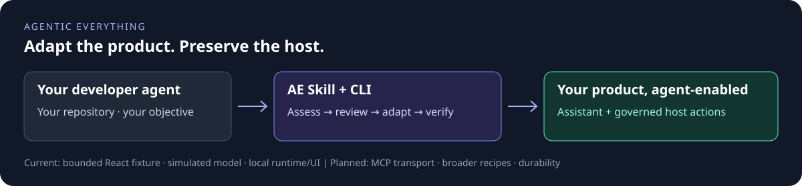

# Agentic Everything

### Give your product agentic capabilities. Keep what makes it yours.

**AE equips the developer agent you already use to adapt an existing product: inspect its code, propose a tailored integration, then deliver approved changes with evidence and a rollback path.**

Keep your product's language, business logic and permissions. Add an embedded assistant and governed actions, not another disconnected chatbot.

[Get started](docs/getting-started.md) · [See the examples](docs/examples.md) · [Integrate](docs/integrating.md) · [中文](docs/README.zh-CN.md) · [Contribute](CONTRIBUTING.md)



> **Source-distributed developer release.** Three bounded recipes adapt a React/TypeScript helpdesk and Python/SQLite and Java/Spring Core inventory hosts through the same lifecycle. The shared core includes a governed runtime, floating assistant and administration tab, opt-in PostgreSQL/DBOS recovery, and fixed-source install/upgrade tools. All recorded model runs are simulated; fixture qualification is not production readiness. [Core acceptance and release scope](docs/acceptance-status.md).

## From an existing app to an agentic product

The first example begins with a plain ticket page, not a prebuilt AI demo.

| Before | AE adaptation | What stays yours |
| --- | --- | --- |
| React ticket page with ordinary domain functions | Inspect the known source layout and preview a two-file integration | The original language and app |
| No assistant or Agentic tab | Add a host-mounted surface in an isolated Git worktree | The original source worktree |
| Priority and assignee business functions | Route model-requested actions through host authorization and bound approval | The existing business function and resource version checks |
| No execution evidence | Show run events and operation receipts; stop on unknown outcomes | The host remains the authority |

The [helpdesk fixture](fixtures/existing-react-helpdesk), [versioned recipe](recipes/react-helpdesk/1.1.0/recipe.json) and [tests](packages/transformation/test/transformation.test.ts) are in the repository. A second [Python inventory fixture](fixtures/existing-python-inventory) reserves stock for an order through the same core, with its own original baseline and receipt protocol. These recipes recognize explicit reviewed layouts; they do not claim general semantic understanding of arbitrary codebases. Helpdesk and inventory are proving grounds, not industry boundaries.

## Start with your own developer agent

Open this checkout in your existing developer agent and give it this prompt:

> Read skills/ae-adapt/SKILL.md and docs/getting-started.md. Try AE on a disposable copy of the included helpdesk fixture. Include the fixed synthetic verification profile in one plan. Show me the source assessment, proposed diff, plan hash, verification actions and limits before applying changes. After I approve, complete the permitted checks and deliver the inspectable bundle with its actual scope and status. Preserve the host stack and business rules. Do not deploy, use paid APIs or modify another project.

The Skill is available now as repository instructions. The integration path is **developer agent → AE Skill / read-only MCP toolkit → tailored product adaptation**. AE is not a replacement coding agent, and the local MCP toolkit is runnable after build; mutation authority stays with the developer host.

The intended interaction is one project request, one consolidated plan approval, then delivery. Your developer agent does the approved engineering and reports evidence or an exact blocker, rather than asking you to operate every command. New costs, credentials, deployment or expanded permissions still need the corresponding authorization. The installed recipes are deliberately bounded; generic assessment is useful outside them, but an unsupported project needs a reviewed tailored implementation, not a fake successful automatic adaptation. AE is MIT-licensed and requires no AE website, registration, account or service key. Your host and any real model provider retain their own security configuration.

### Or start in a terminal

From an existing checkout, with **Node 24, npm 11 and Git**:

```bash
npm ci --ignore-scripts
npm run check
```

No model key, account or database is needed for these local checks. Dependency download needs network access. Then follow the [copy-and-preview walkthrough](docs/getting-started.md): it keeps your source untouched and shows the exact patch before approval. For a pinned managed copy, use the [fixed-source installation and doctor commands](docs/operations.md). There is no published npm package or signed release claimed by this checkout.

## What works today

| Area | Current scope | Evidence / next step |
| --- | --- | --- |
| Adaptation | Skill, CLI and read-only MCP; source-bound plan/approval, pre-apply baseline, isolated patch, comparison, delivery and guarded revert; React helpdesk, Python inventory and Java/Spring Core profiles | [Walkthrough](docs/getting-started.md) · [Delivery contract](docs/delivery.md) · [Inventory](docs/verification/cross-stack-inventory.md) |
| Runtime | One official Agents JS loop, shared host authorization/approval/receipts, explicit memory or PostgreSQL/DBOS mode; conversation continuity and immutable releases | [Persistence](docs/PERSISTENT_RUNTIME_QUALIFICATION.md) · [Joined release](docs/verification/joined-release-qualification.md) · [Conversations](docs/verification/conversation-ui.md) |
| Host surfaces | Draggable daily assistant, in-chat confirmations and host administration tab; optional Console uses the same backend; bounded domain-neutral references | [Integration](docs/integrating.md) · [Non-ticket browser evidence](docs/verification/generic-host-ui.md) |
| Java and MCP | Additive Java/Spring Core lifecycle recipe plus official authenticated read-only MCP Streamable HTTP subset | [Recipe evidence](docs/verification/java-spring-recipe.md) · [Remote contract](docs/verification/java-spring-remote-mcp.md); exact fixture, not Boot/MVC or production OAuth |
| Deterministic workflows | Versioned trusted-server read/branch/approval/terminal-write definitions, bounded read retries and persistent recovery on the same DBOS owner | [Workflow subset](docs/verification/deterministic-workflows.md); no model, parallel graph, canvas or automatic write retry |
| Model contracts | AE-native injectable model port and official SDK Chat Completions-compatible HTTP adapter | [Second contract](docs/verification/second-provider-contract.md); synthetic responder, not live-model quality/cost |
| Operations | Fixed-source install/doctor/side-by-side upgrade/uninstall, one AE migration owner, backup/restore, configuration transfer, durable admission and scoped projection retention | [Runbook](docs/operations.md) · [Qualification](docs/verification/release-operations.md) |
| Optional extensions | Bounded DBOS automation, declared official A2A subset, mobile bridge contract experiment | [Support and limits](packages/extensions/README.md); knowledge disabled and real mobile platform unverified |
| Not claimed | Arbitrary automatic adaptation, production identity/scale/SLA, live-provider quality, whole-account erasure, universal mobile SDKs or deployment | [Support matrix](docs/support-matrix.md) · [Core acceptance and release scope](docs/acceptance-status.md) |

Each report names its tested inputs and limits. Static checks, unit tests, real HTTP/database runs and browser acceptance are distinct evidence; none silently certifies another host or deployment. The default in-memory fixture loses run/approval/operation state on restart. The opt-in persistent composition has separate recovery evidence and requires a qualified host receipt protocol. Do not expose the synthetic fixture or put customer data into it.

The bounded core release is accepted at the recorded source and environments. The three external adaptations are separate deliverables still in progress; they will receive real before/after repository links and screenshots only after verification, never placeholder URLs.

## How the pieces fit

- **Adapt the product:** `skills/ae-adapt`, `packages/transformation` and `packages/cli` produce a reviewable change set rather than silently rewriting an app.
- **Govern the actions:** `packages/runtime-core`, `capabilities` and `policy` enforce the execution path. Model output and page context never grant authority.
- **Meet users in their product:** `packages/host-sdk` and `ui` mount the experience; `apps/console` offers a separate entry to the same backend.

AE is an independent product with a native TypeScript core. **Your host keeps its own technology stack.** The Python and Spring Core recipes demonstrate separate host boundaries; Go, PHP, .NET and other integrations still need their own reviewed implementation and qualification. No fixture grants blanket stack support.

## Build with us

A useful contribution is a reproducible improvement: a new fixture, a failing permission/recovery test, a narrowly scoped recipe, or a clearer first-run experience. [Contributing](CONTRIBUTING.md) explains where to start and what evidence to include.

[Documentation index](docs/README.md) · [Troubleshooting and support](SUPPORT.md) · [Security boundaries](SECURITY.md)

## License and provenance

[MIT](LICENSE). AE preserves the EnterpriseAgentFramework attribution and license; see [NOTICE](NOTICE.md), [runtime provenance](packages/runtime-core/docs/PROVENANCE.md) and [Skill provenance](skills/ae-adapt/references/provenance.md). Third-party dependencies retain their own licenses. Repository presentation research is recorded [here](docs/research-repository-patterns.md); no upstream branding or demo assets are reused.
